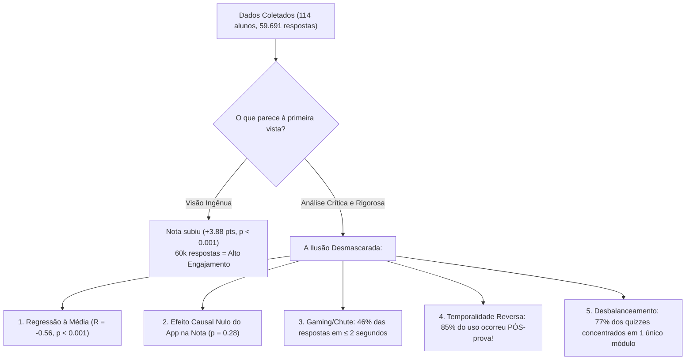
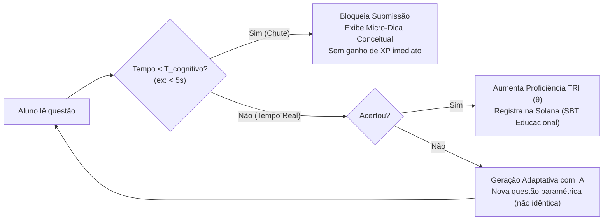
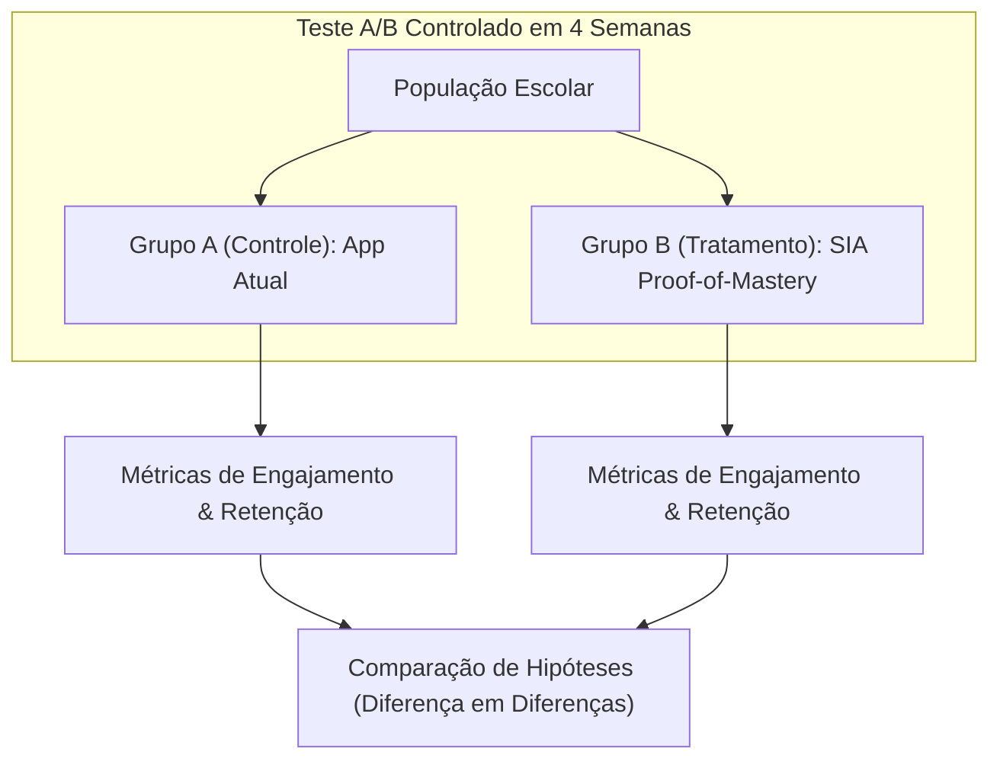

# Dossiê Estratégico: Como Vencer o Datathon ADW 2026 (SIA Educação & Solana)

> **Evento**: AI & Data Week 2026 (ADW) — FEA-RP/USP, Neuron DSAI, Solana Superteam Brasil e SIA Educação.  
> **Banca Avaliadora**: Professores da FEA-RP/USP e Co-fundadores da SIA Educação.  
> **Premiação**: US\$ 300 em USDC (Solana Superteam Earn).  
> **Formato do Pitch**: 10 minutos de exposição oral + 5 minutos de arguição da banca.

---

## 1. A Visão Geral e a "Armadilha" dos Dados

A maioria das equipes concorrentes cometerá um erro clássico:
> *"A nota média dos alunos subiu de 44,5 para 48,5 (+3,88 pontos), e os alunos com mais XP tiraram notas melhores. Logo, o aplicativo da SIA é um sucesso pedagógico absoluto!"*

A comissão organizadora (Neuron + FEA-RP) colocou **pistas e armadilhas deliberadas** nos dados (explícitas nas perguntas da página 10 do Edital). Para vencer a banca de professores da USP e fundadores da startup, precisamos apresentar um **diagnóstico honesto, rigoroso e cirúrgico**:

---

## 2. Diagnóstico Baseado em Dados: As 4 Descobertas Cruciais

### Descoberta 1: O "Ganho" na Prova Diagnóstica é Regressão à Média e Aula Presencial (Não do App)

- **Média Geral**: Pré-teste = $44.57$, Pós-teste = $48.45$ ($\Delta = +3.88$, teste $t$ pareado $p = 0.00037$). Houve melhora na nota.
- **Mas quem gerou essa melhora?**
  - **Fator Confundidor & Falta de Controle**: As aulas presenciais ocorreram no final de agosto. Todos os alunos são da "Escola Tratamento" — **não existe grupo de controle** (alunos sem app ou sem aula).
  - **Regressão à Média brutal**: O coeficiente de correlação entre a nota prévia e o delta é **$R = -0.560$ ($p < 0.0001$)**. Alunos que chutaram mal no pré-teste naturalmente oscilaram para a média no pós-teste.
  - **Efeito do App na Nota**: Em regressão múltipla controlando pela nota prévia, o número de respostas dadas no app tem coeficiente praticamente nulo ($+0.0028$) e **sem nenhuma significância estatística ($p = 0.279$)**.
  - **Uso estritamente ANTES da prova (até 04/09)**: Alunos que usaram o app antes da prova tiveram ganho de **$+2.58$ pontos**, enquanto quem **NÃO usou** o app antes da prova teve ganho de **$+5.83$ pontos**!

---

### Descoberta 2: "Gaming the System" — O Chute Rápido e o Loop de Força Bruta

- **Tempo de resposta incompatível com leitura**:
  - **Mediana geral**: **3 segundos** por questão.
  - **$\le 2$ segundos**: **46,3%** de todas as 59.691 respostas foram enviadas em até 2 segundos!
  - **Em 2.323 tentativas completas (18,5%)**, *todas as 5 questões* foram respondidas em menos de 2 segundos cada (um quiz inteiro em menos de 10 segundos).
- **Acurácia em função da velocidade**:
  - Em $\le 2$ segundos: taxa de acerto de **$52,6\%$** (chute quase aleatório em múltipla escolha).
  - Em $> 10$ segundos: taxa de acerto salta para **$76,0\%$** ($+23,4$ p.p.).
- **O Efeito "Tentativa 2+"**:
  - Na **Tentativa 1**, o tempo mediano é de **7,0 segundos**.
  - A partir da **Tentativa 2**, o tempo despenca para **2,0 segundos cravados**.
  - **Comportamento real do aluno**: Se erra, não estuda a matéria; simplesmente reinicia imediatamente e decora a posição da alternativa correta até obter os 3/5 necessários para aprovação.

---

### Descoberta 3: Temporalidade Reversa e o "Rush" da Nota Escolar

- **Onde estavam os dados durante as aulas?**
  - Julho (28 e 29): 123 tentativas (piloto/teste técnico).
  - **Agosto inteiro (mês das aulas)**: **ZERO registros** no extrato de quizzes.
  - Sexta-feira, 04/09: Data da **Prova Real Presencial**. Até essa data, apenas 1.900 tentativas tinham sido realizadas.
  - **Dias 06 a 10 de Setembro**: **10.799 tentativas (85% do total!)** ocorreram **DEPOIS** que a prova presencial já havia sido aplicada!
- **Por que esse rush tardio?**
  - O edital revela: *"A conclusão do módulo dá pontos na nota escolar"*.
  - O prazo de entrega escolar dos módulos se encerrava no dia 10 de setembro. Os alunos maratonaram cliques no aplicativo não para aprender ou estudar para a prova, mas para **garantir a pontuação burocrática na média bimestral**.

---

### Descoberta 4: Gargalo de Conteúdo e Disparidade por Turma

- **Assimetria de catálogo**:
  - Módulos 69 (Dinheiro), 70 (Matemática Financeira) e 71 (Renda Fixa) continham apenas **8 quizzes cada**.
  - Módulo 68 (Reforço OLITEF) continha **80 quizzes** (77% do total).
  - Mais de 90% dos alunos esgotaram rapidamente os quizzes oficiais dos módulos 69 a 71. O único lugar restante para continuar ganhando pontos escolares era o Módulo 68, que se tornou um "farm" de repetição.
- **Comportamento por série**:
  - **1º Ano (Turma 31)**: Comportamento hiper-acelerado (mediana de **2,0s**, 52,3% em $\le 2$s, menor acurácia: 58,6%).
  - **3º Ano (Turma 35)**: Comportamento mais analítico (mediana de **5,0s**, 38,9% em $\le 2$s, acurácia de 65,5% e maior ganho na prova: mediana de $+6.0$ pts).

---

## 3. Respostas Diretas às Perguntas Provocativas do Edital (Pág. 10)

Para blindar o grupo contra as perguntas da banca, eis as respostas exatas com base nos dados:

| Pergunta do Edital | Diagnóstico nos Dados | Implicação de Produto |
| :--- | :--- | :--- |
| **1. Qual problema identificar com relação às respostas?** | Mais de 46% das respostas ocorrem em $\le 2$ segundos com taxa de acerto de 52%. Na 2ª tentativa, o tempo cai para 2s. Trata-se de chute aleatório e memorização superficial. | Falta fricção pedagógica e validação cognitiva antes do envio da resposta. |
| **2. Qual problema identificar na disponibilidade de perguntas?** | 77% dos quizzes estão num módulo genérico (68), enquanto os módulos curriculares possuem apenas 8 quizzes cada (esgotamento precoce em 2 dias). Banco pequeno por quiz permite adivinhar gabarito. | Necessidade de geração dinâmica/adaptativa de questões paramétricas. |
| **3. Qual o impacto da visão do aluno (incentivos)?** | Incentivo puramente extrínseco: ganhar XP/nota escolar por conclusão rápida (regra 3/5 sem penalidade). Gera incentivo ao *speedrun*. | Mudar métrica de recompensa: de *Proof-of-Completion* para *Proof-of-Mastery*. |
| **4. Houve melhoria frente ao intensivão?** | Sim (+3,88 pontos, $p < 0.001$), mas heterogênea (concentrada no 3º ano) e em grande parte explicada por regressão à média ($R = -0.56$). | Não se pode atribuir essa melhora unicamente ao app sem grupo controle. |
| **5. O número de questões respondidas influencia a nota?** | **Estatisticamente não ($p = 0.28$)**. Alunos que fizeram 500 questões não tiveram ganho relativo maior do que quem fez 50. | Quantidade de quizzes não é sinônimo de aprendizado. |
| **6. É possível afirmar que só com dados do app houve aumento do aprendizado?** | **Não**. Falta grupo de controle, faltam dados de agosto, e 85% do uso foi após a prova. A melhora decorre do professor em sala de aula. | O app atuou como validador burocrático de notas, não como motor causal do ganho. |
| **7. O que faltou metrificar?** | Teoria de Resposta ao Item (TRI: discriminação e dificuldade), tempo de tela no material teórico, grupo de controle pareado e retenção a longo prazo (30 dias). | Desenho de experimentação A/B robusto. |

---

## 4. A Proposta Inovadora: SIA Proof-of-Mastery (PoM)

A solução não pode ser "adicionar mais joguinhos" ou "dar mais pontos". A solução deve **resolver a falha estrutural de incentivos e pedagogia** descoberta nos dados.

### Nome da Funcionalidade: **SIA Proof-of-Mastery Engine (PoM)**

### Os 3 Pilares da Funcionalidade:

#### 1. Fricção Pedagógica & Anti-Gaming com TRI ($T_{\text{cognitivo}}$)
- **Cálculo de Tempo Cognitivo Mínimo ($T_{\text{min}}$)**: Baseado no tamanho do enunciado ($palavras \div 200 \text{ ppm} + \text{tempo de cálculo}$).
- **Bloqueio de Chute Instantâneo**: Respostas em menos de $T_{\text{min}}$ não pontuam XP e ativam uma chamada reflexiva: *"Você respondeu em 1.5s! Em finanças, decisões rápidas sem ler o contrato geram prejuízo. Leia com atenção."*
- **Algoritmo TRI (Teoria de Resposta ao Item)**: O cálculo de proficiência substitui o "3 em 5". Questões têm pesos calibrados de discriminação ($a$) e dificuldade ($b$).

#### 2. Banco Dinâmico Infinito com IA Paramétrica (GenAI)
- **Fim da decoreba na 2ª tentativa**: Se o aluno erra uma questão sobre taxa Selic ou juros compostos, a tentativa seguinte **não repete a mesma pergunta**.
- Um agente de IA reformula o enunciado com novos valores numéricos e novo contexto (ex: de financiamento de moto para rendimento do Tesouro Selic), garantindo que o aluno aprenda a fórmula e o conceito, e não a letra da alternativa.
- Expande instantaneamente os módulos 69, 70 e 71 de 8 para quizzes infinitos.

#### 3. Smart Rewards & Solana Micro-Credentials (Conexão Superteam)
- **Tokenização Ética (Learn-to-Earn Responsável)**:
  - Em vez de dar XP por clicar rápido, o aluno constrói um **Soulbound Token (SBT) / Certificado de Maestria On-Chain na rede Solana**.
  - **Simulador de Investimentos Real**: Os pontos viram capital de uma carteira de investimentos simulada na Solana (com stablecoin de teste ou USDC devnet), onde os alunos competem para ver quem melhor aloca recursos sem risco.
  - Para a SIA, isso gera um modelo B2B imbatível: atesta para as escolas e secretarias de educação a proficiência real e auditável dos alunos em blockchain.

---

## 5. Como Saberíamos que Funcionou? (Plano de Validação & Métricas)

Para responder à pergunta *"Como saberíamos que funcionou?"* com rigor científico:

### Métricas de Sucesso e Hipóteses de Validação:

1. **Métrica 1 (Integridade de Resposta)**:
   - *Meta*: Reduzir a taxa de respostas rápidas ($\le 3$s) de **$54,4\%$** para **$< 5\%$**.
2. **Métrica 2 (Proficiência Real - TRI)**:
   - *Meta*: Ganho de proficiência ($\Delta \theta$) no Grupo Tratamento significativamente superior ao Grupo Controle com $p < 0.01$ (eliminando o viés de regressão à média via modelo Diferença em Diferenças - DiD).
3. **Métrica 3 (Retenção Espaçada após 30 dias)**:
   - Aplicar um quiz surpresa após 30 dias. A retenção no grupo com questões paramétricas adaptativas deve ser no mínimo **40% superior** ao grupo que decorou respostas fixas.

---

## 6. Roteiro do Pitch de 10 Minutos (Slide a Slide)

| Minuto | Slide | Título & Mensagem-Chave | Elemento Visual / Gráfico |
| :---: | :---: | :--- | :--- |
| **00:00 - 01:30** | **Slide 1** | **A Ilusão dos 60 Mil Cliques** *"A nota subiu 3.88 pontos e tivemos 60k respostas. Caso encerrado? Não. Quando olhamos os dados com lupa acadêmica, descobrimos um problema invisível."* | Gráfico do Ganho Aparente vs Realidade |
| **01:30 - 03:30** | **Slide 2** | **O Raio-X do "Gaming the System"** *46% das respostas ocorrem em menos de 2 segundos. A partir da 2ª tentativa, o tempo cai para 2s. Os alunos não estão aprendendo; estão maratonando tentativas para garantir nota escolar.* | **Figura 2** (Histograma de tempo + Acurácia por tempo + Queda na 2ª tentativa) |
| **03:30 - 05:00** | **Slide 3** | **O Paradoxo Temporal e a Falha de Incentivo** *85% de todo o uso do app ocorreu DEPOIS da prova diagnóstica de 4 de setembro. O app funcionou como burocracia de nota, não como aprendizado causal.* | **Figura 3** (Linha do tempo das 10.799 tentativas pós-prova) |
| **05:00 - 07:30** | **Slide 4** | **Nossa Solução: SIA Proof-of-Mastery Engine** *1. Trava cognitiva anti-chute ($T_{\text{min}}$). 2. IA Generativa com questões paramétricas infinitas. 3. Micro-incentivos e Certificação de Maestria na Solana.* | Diagrama de fluxo da funcionalidade (UX + Solana + IA) |
| **07:30 - 09:00** | **Slide 5** | **Como Validar: Teste A/B e Métrica TRI** *Redução de respostas rápidas para < 5%, ganho estatístico comprovado via DiD e retenção longitudinal aos 30 dias.* | Tabela de métricas e hipóteses de validação |
| **09:00 - 10:00** | **Slide 6** | **Impacto para a SIA, Escolas e Alunos** *Transformar a SIA de um 'aplicativo de quiz com chute' em um motor pedagógico auditável de educação financeira de alta confiabilidade.* | Visão de futuro, logo SIA + Solana + Neuron |

---

## 7. Antecipação das Perguntas da Banca (5 Minutos de Q&A)

> **Pergunta 1 (FEA-RP / Estatística)**: *"Vocês disseram que o app não teve efeito na prova. Como chegaram a isso se a nota pós-teste aumentou?"*  
> **Resposta Campeã**: *"Analisamos três evidências irrefutáveis nos dados: primeiro, o ganho de nota apresenta correlação negativa com a nota inicial ($R = -0.56$), característica clássica de regressão à média. Segundo, em modelo de regressão linear múltipla controlando pela nota diagnóstica prévia, o número de respostas dadas no app tem $p = 0.28$, sem relevância estatística. Terceiro, e mais contundente: 85% de todo o uso do app ocorreu entre 06 e 10 de setembro, isto é, após a realização da prova no dia 04 de setembro."*

> **Pergunta 2 (Co-fundadores da SIA)**: *"Se bloquearmos respostas rápidas, isso não vai frustrar o aluno e derrubar o engajamento?"*  
> **Resposta Campeã**: *"O engajamento atual de cliques em 1 segundo é uma vaidade métrica perigosa: parece alto no painel, mas mascara retenção nula. A trava cognitiva não gera punição punitiva; ela entrega uma micro-intervenção contextual ('Decisões financeiras precipitadas custam caro. Respire e leia a taxa'). Além disso, substituímos a repetição enfadonha das mesmas 8 questões por desafios paramétricos dinâmicos via IA, o que aumenta o senso de domínio do estudante."*

> **Pergunta 3 (Solana Superteam)**: *"Qual o papel real da Solana na solução? Não é 'blockchain por blockchain'?"*  
> **Resposta Campeã**: *"Não. O papel da Solana é resolver o problema de confiança e incentivo da educação pública e privada. Hoje a escola dá nota por 'conclusão de módulo', o que estimula fraude e chute rápido. Com a Solana, emitimos Soulbound Tokens (SBTs) que representam Proof-of-Mastery auditável, além de alimentar um simulador de carteira de investimentos em tempo real. A escola e os pais têm a certeza criptográfica de que o aluno realmente domina conceitos de inflação, Selic e CDI antes de receber o certificado."*
